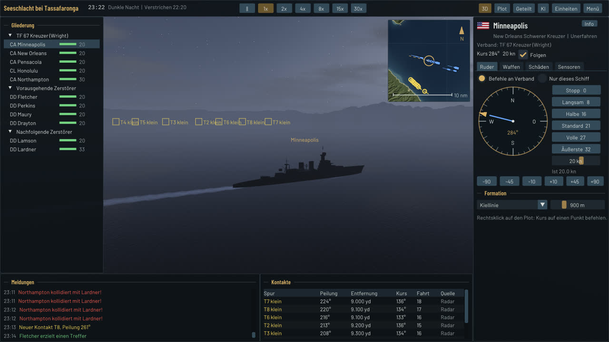
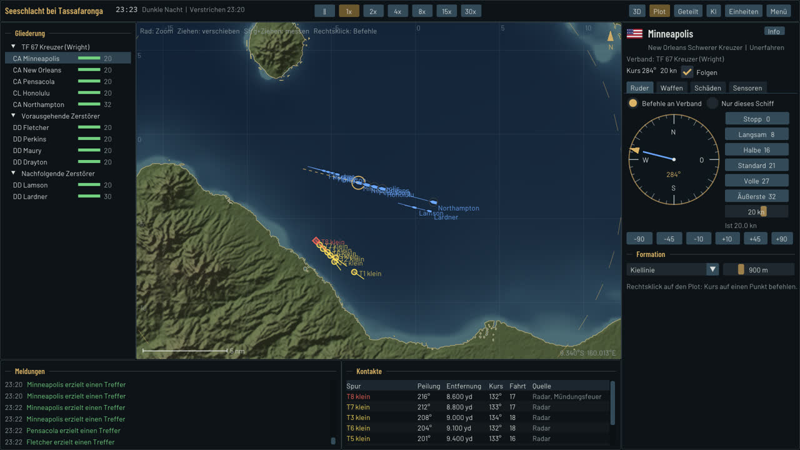
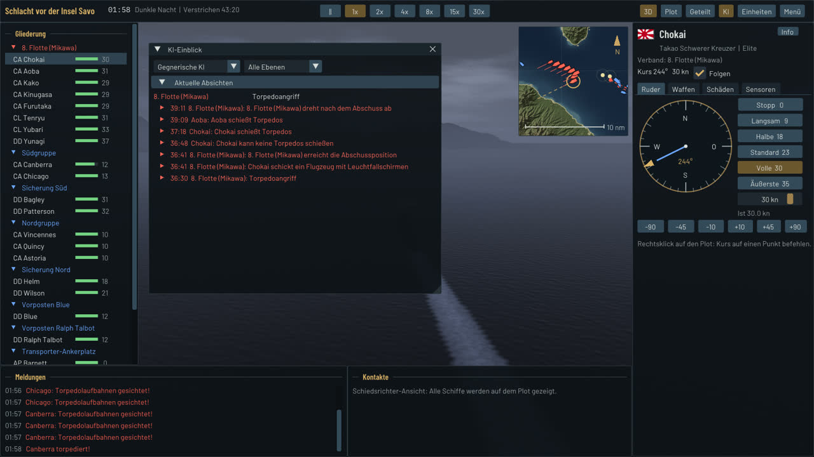
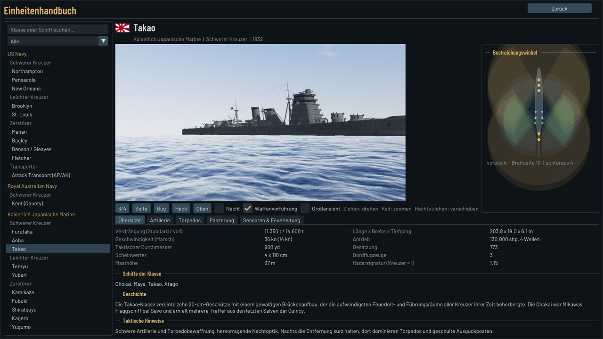
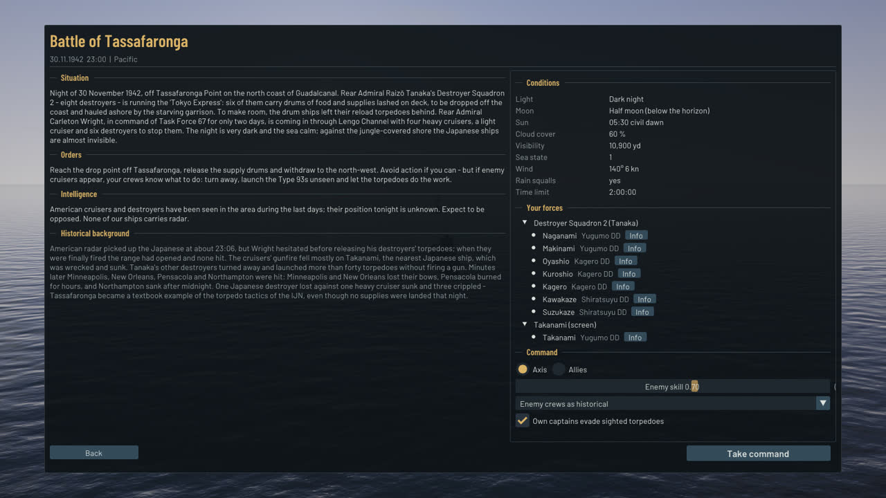

# Iron Tide: Naval Command 1939–45

Taktische Marinesimulation im Zweiten Weltkrieg für Windows – nach dem Vorbild von *Sea Power*,
aber im Raketen-losen Zeitalter: Nachtgefechte, Torpedofächer, Leuchtgranaten, frühes Radar.
Eigene C++20-Engine auf **Direct3D 12**, deutsch und englisch.

*A WWII naval tactics game for Windows (custom C++20 / Direct3D 12 engine, German and English).
You command cruisers and destroyers in historical night actions off Guadalcanal against an AI that
only knows what its own lookouts and radars report.*



## Inhalt

- **Drei historische Missionen** im Ironbottom Sound, jede aus beiden Seiten spielbar:
  Savo Island (8./9. Aug. 1942), Cape Esperance (11./12. Okt. 1942), Tassafaronga (30. Nov. 1942).
  Briefing mit Lage, Auftrag, Aufklärung, astronomisch berechneten Lichtverhältnissen und Geschichte.
- **Szenario-Editor** für eigene Gefechte (Verbände, Wegpunkte, Aufträge, Doktrin, Zeit und Wetter).
- **Simulation**: Außenballistik und Panzerdurchschlag, Feuerleitung mit Richtungsgeber-Verfolgung
  und Salvenbeobachtung, Torpedos mit Laufstufen und Laufbahnen, Schäden mit Wassereinbruch,
  Krängung, Bränden, Munitionskammern und Kentern.
- **Sensoren**: Sicht nach Licht, Mond, Wolken, Regenböen und Hintergrund (Inseln), Mündungsfeuer,
  Scheinwerfer, Leuchtgranaten und Fallschirmleuchtbomben; Radar SC/SG/FC mit Landechos und
  Funkschatten; Torpedolaufbahnen. Kontakte laufen mit Meldeverzug in ein Lagebild je Seite.
- **Gegner-KI**: hierarchisch (Befehlshaber → Verband → Kommandant), Utility-Bewertung mit
  Doktrinen (IJN 1942, USN 1942/Ende 1942, RAN), **fair** – sie sieht nur ihr eigenes Lagebild.
  Der **KI-Einblick** zeigt jede Entscheidung mit Alternativen und Gewichtungen.
- **Taktische Ansicht (Plot)** mit Küstenkarte, Kontakten nach eigenem Lagebild, Peil- und
  Entfernungsmessung und Befehlen per Rechtsklick; 3D-Ansicht mit Orbit-, Brücken- und
  Fernglaskamera; geteilte Ansicht.
- **Einheitenhandbuch**: drehbare, zoombare 3D-Vorschau mit Großansicht, Nachtbeleuchtung und
  **Waffenvorführung** (Türme schwenken, Salven mit Rückstoß je Rohr, Mündungsfeuer und
  Pulverrauch, Torpedoausstoß, Katapultstart des Bordflugzeugs), Bestreichungswinkel,
  Durchschlagstabelle gegen gewählte Gegnerklassen, Panzerung, Torpedos, Sensoren und Geschichte
  für 21 Schiffsklassen.
- **Schiffsmodelle**: prozedural aus den Klassendaten, je Marine im eigenen Stil – Rumpf mit
  Panzergürtel bzw. Wulst, Schanzkleid, Wellenbrecher, Anker und Kette, Wellen, Schrauben und
  Ruder; Brücken und Pagodenmasten mit Fensterbändern, Nocken und Splitterschutz; Schornsteine
  mit Kappen, Funkenfängern und Dampfrohren; Masten mit Plattformen, Rahen, Signallampen und
  Antennendrähten; Feuerleitstände (Mk 33/34/37, Typ 94) mit Entfernungsmessern und
  Radarantennen (SC, SG, Mk 3, Mk 4); Türme mit Visierhauben, Messgeräte-Ohren und Mündungs-
  schutzhüllen; leichte Flak (20 mm, 1,1″, 25 mm, 13 mm, Pom-Pom); Bordflugzeuge mit
  Hoheitszeichen; Beiboote an Davits, Carley-Flöße, Relinge, Niedergänge, Poller, Lüfter,
  Wasserbomben; wehende Kriegsflagge. Materialtexturen (Plattenstöße, Teak, Linoleum mit
  Messingleisten, Rutschbelag, Segeltuch) mit Rost, Salz und Bullaugen; Detailstufen nach
  Bildschirmgröße.
- **Animationen**: Türme, Rohre und Leitstände folgen der Feuerleitung, jedes Rohr läuft nach dem
  Schuss zurück, Torpedos verlassen die Rohre, Flak folgt feindlichen Flugzeugen, Bordflugzeuge
  werden vom Katapult gestartet und fliegen ihre Einsätze sichtbar, Scheinwerfer richten in Seite
  und Höhe, Radarantennen drehen, Schrauben und Ruder bewegen sich, zerstörte Lafetten hängen.
- **Grafik**: FFT-Ozean mit Schaum und Kielwasser, Nachthimmel mit Mond und Sternen,
  HDR mit Augenadaption, Bloom und MSAA, Schattenkarten, Partikel für Mündungsfeuer, Rauch,
  Einschläge und Brände. Feature Level 12_0, kein Raytracing nötig.
- **Audio** (XAudio2): Geschütze, Einschläge und Explosionen mit Schall-Laufzeit, Ambience,
  Maschinentelegraf, Alarmglocke und Brückenmeldungen auf Deutsch und Englisch.

| Plot | KI-Einblick |
|---|---|
|  |  |
| **Einheitenhandbuch** | **Briefing** |
|  |  |

## Systemvoraussetzungen

- Windows 10 (64 Bit) oder Windows 11
- Grafikkarte mit Direct3D 12, Feature Level 12_0 (z. B. GeForce GTX 900, Radeon RX 400,
  Intel UHD 600 oder neuer); ohne GPU läuft das Spiel langsam auf dem WARP-Software-Renderer
- etwa 30 MB Speicherplatz

Fertige Builds liegen als Artefakt `IronTide-windows-x64` an jedem
[CI-Lauf](../../actions/workflows/ci.yml). Entpacken, `IronTide.exe` starten.

## Steuerung

| Taste / Maus | Funktion |
|---|---|
| Leertaste | Pause |
| 1 – 6 | Zeitraffer 1×, 2×, 4×, 8×, 15×, 30× |
| F1 / F2 / F3, M | 3D-Ansicht / Plot / geteilt, M wechselt 3D ↔ Plot |
| Tab, Umschalt+Tab | nächstes / vorheriges eigenes Schiff |
| F | Kamera folgt dem gewählten Schiff |
| B / V | Brückenkamera / Fernglas |
| I / U | KI-Einblick / Einheitenhandbuch |
| H | Bedienoberfläche aus- und einblenden |
| Esc | Pausenmenü |
| 3D: rechte oder mittlere Maustaste ziehen, Rad, W A S D | Kamera drehen, zoomen, verschieben (Umschalt: schneller) |
| 3D: Linksklick | Schiff wählen |
| Plot: ziehen, Rad, Strg+ziehen | verschieben, zoomen, Peilung und Entfernung messen |
| Plot: Rechtsklick | Befehle (Verband oder Schiff auf einen Punkt steuern, Plot zentrieren) |

Ruder, Maschine, Formation, Ziele, Feuererlaubnis, Torpedofächer, Scheinwerfer, Leuchtgranaten und
Bordflugzeuge befiehlt man im Schiffspanel rechts.

## Bauen

Benötigt CMake ≥ 3.25 und Ninja (Linux/MinGW) bzw. Visual Studio 2022.

**Windows (MSVC)**

```bat
cmake --preset msvc
cmake --build --preset msvc-release
build\msvc\Release\IronTide.exe
```

**Windows-Build unter Linux (MinGW-w64, POSIX-Threads)**

```sh
cmake --preset mingw-release
cmake --build --preset mingw-release      # build/mingw-release/IronTide.exe
```

**Simulationskern, KI und Tests unter Linux**

```sh
cmake --preset linux-debug
cmake --build --preset linux-debug
ctest --test-dir build/linux-debug --output-on-failure
# KI gegen KI, 20 Durchläufe:
build/linux-debug/irontide_headless --data data --scenario savo_island --runs 20 --log --events
```

Nützliche Startparameter des Spiels: `--lang de|en`, `--data <ordner>`, `--log <datei>`,
`--no-audio`, `--msaa 1|2|4|8`, `--size 1920x1080`, `--d3d-debug`. Für Tests und Bildschirmfotos
gibt es eine Automatisierung (`--screen`, `--scenario`, `--side`, `--advance`, `--screenshot` …),
siehe [docs/TESTING.md](docs/TESTING.md).

## Projektaufbau

```
src/core      Mathematik, JSON, Dateien, Lokalisierung, Protokoll
src/sim       Welt, Schiffe, Ballistik, Feuerleitung, Torpedos, Schäden, Sensoren, Lagebild, Gelände, Astronomie
src/ai        Befehlshaber/Verband/Kommandant, Doktrinen, Lagebeurteilung, Navigation, Entscheidungsprotokoll
src/game      Szenarien und Gefechtssitzung (Ziele, Wertung, Spielerbefehle)
src/procgen   Prozedurale Schiffsmodelle aus Klassendaten, glTF-Import
src/render    Direct3D-12-Renderer (Ozean, Gelände, Schiffe, Effekte, Nachbearbeitung)
src/ui        Dear-ImGui-Oberfläche: Menüs, Briefing, Gefecht, Plot, Handbuch, Editor, Nachbesprechung
src/audio     XAudio2
src/platform  Win32-Fenster, Hauptschleife
data/         Datenbank (Schiffe, Geschütze, Torpedos, Sensoren), Doktrinen, Szenarien, Gelände,
              Shader, Schriften, Audio, Sprachdateien
tools/        Headless-Batches, Modellbetrachter, Sprach-, Audio-, Gelände- und Icon-Werkzeuge
tests/        doctest-Suite (Simulation, KI, Datenbank, Modelle, Oberfläche)
docs/         Architektur (DESIGN.md), Teststrategie (TESTING.md), Entscheidungen (adr/)
```

Texte werden in `tools/loc/strings_ui.py` und `tools/loc/strings_content.py` gepflegt und mit
`python3 tools/loc/build_loc.py` nach `data/loc/{de,en}.json` erzeugt.

## Lizenz und Quellen

Quellcode unter der [GNU AGPL-3.0](LICENSE). Schriften, Gelände, Audio und Bibliotheken siehe
[CREDITS.md](CREDITS.md).
